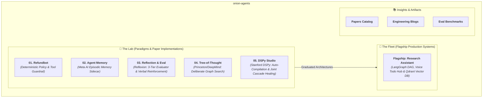

# 🧅 Onion Agents — Monorepo Architecture Directory

This repository organizes specialized autonomous AI agent architectures into two distinct pillars:
* **🔬 The Lab**: Algorithmic & mathematical paper implementations with interactive visual testbenches.
* **🚀 The Fleet**: Flagship production multi-agent systems.

---

## 🏛️ System Architecture Graph

---

## 🗂️ Paradigm Roster

| Layer | System Name | Directory | Core Architectural Paradigm | Tech Stack | Status |
|---|---|---|---|---|---|
| **Lab 01** | **Refundbot** | [`lab/paradigm-01-refundbot`](./lab/paradigm-01-refundbot) | Deterministic Guardrails & Immutable Tool Contracts | Python, FastAPI, SQLite | Production Ready |
| **Lab 02** | **Agent Memory** | [`lab/paradigm-02-agent-memory`](./lab/paradigm-02-agent-memory) | Meta AI Episodic Memory Companion | Python, Event-Driven Sidecar | Active Lab |
| **Lab 03** | **Reflection Eval** | [`lab/paradigm-03-reflection-eval`](./lab/paradigm-03-reflection-eval) | 3-Tier Reflexion Evaluator Loop (Code ➔ LLM Judge ➔ Human) | Python, Scikit-learn, Evaluators | Production Ready |
| **Lab 04** | **Tree of Thought** | [`lab/paradigm-04-tree-of-thought`](./lab/paradigm-04-tree-of-thought) | Deliberate Problem Solving via Heuristic BFS/DFS Search | Python, Graph Search Engine | In Development |
| **Lab 05** | **DSPy Studio** | [`lab/paradigm-05-dspy-self-tuning`](./lab/paradigm-05-dspy-self-tuning) | Stanford DSPy Compilers (`BootstrapFewShot`) & Multi-Agent Joint Optimization | DSPy 3.4.1, Groq, FastAPI | Production Ready |
| **Fleet 01** | **Research Assistant** | [`fleet/b-research-agent`](./fleet/b-research-agent) | Multi-Agent Autonomous Research Engine + Voice Todo Hub | LangGraph, FastAPI, Qdrant, React 18 | Production Ready |

---

## 📐 Engineering Standards
1. **Isolated Environments**: Standalone dependency definitions (`pyproject.toml`, `requirements.txt`) allowing independent deployment.
2. **Deterministic Evaluation**: Every paradigm includes gold evaluation test sets and measurable metrics.
3. **Interactive Sandboxes**: Visual testbenches allowing live inspection of model behavior.
